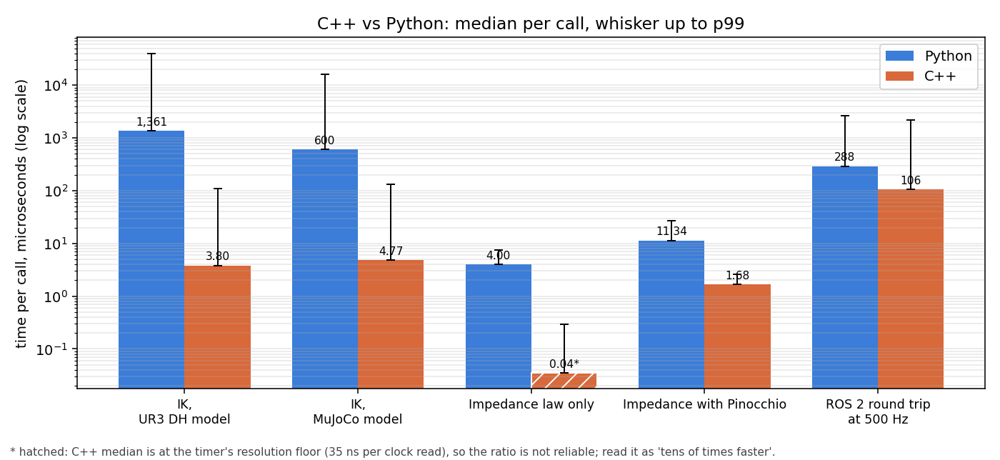
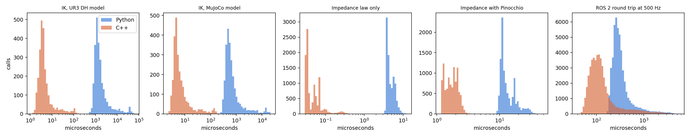

# ctrlbench

[](https://github.com/darshmenon/ctrlbench/actions/workflows/ci.yml) [](https://github.com/darshmenon/ctrlbench/releases) [](LICENSE)  

A measured C++ vs Python comparison of the building blocks of arm control, on a UR3, on one real (busy) machine. Every implementation pair is first checked to give the same answer, then timed many times.



## What is measured

| Benchmark | Python | C++ |
|---|---|---|
| IK, UR3 DH model: damped least squares, 6D pose error | numpy | Eigen |
| IK, MuJoCo model: same solver on the UR3 MJCF, `mj_jacSite` for the Jacobian | `mujoco` bindings | MuJoCo C API |
| Impedance law only: `tau = J^T (K e - D J v) + g` with J, g, e precomputed | numpy | Eigen |
| Impedance with Pinocchio: FK, frame Jacobian, gravity, rotation error, then the law | `pinocchio` | `pinocchio` |
| ROS 2 round trip: node subscribes `/joint_states` at 500 Hz, checks it, publishes a reply | `rclpy` | `rclcpp` |

Same inputs in both languages (500 reachable IK targets, 2000 impedance states, fixed seeds), same solver settings and gains, one untimed warm-up pass, then a timed pass. The ROS 2 harness is a separate C++ process that stamps each message, so the latency is publish stamp to reply received, through DDS twice. It runs on `ROS_DOMAIN_ID=88` with a fake publisher, no simulator.

## Results

5 repeats, Python and C++ interleaved, each pinned to the least busy of the first 12 logical cpus. The tables show the median over repeats of each repeat's median and p99.

| Benchmark | Python median | C++ median | Python p99 | C++ p99 | Python / C++ (median) | Spread of repeat medians (py, C++) |
|---|---|---|---|---|---|---|
| IK, UR3 DH model | 1,361 us | 3.80 us | 40,173 us | 108 us | 358.4x | 1,115 to 1,702 us, 2.83 to 4.02 us |
| IK, MuJoCo model | 600 us | 4.77 us | 16,308 us | 133 us | 125.9x | 482 to 606 us, 4.41 to 7.37 us |
| Impedance law only | 4.00 us | 0.04 us | 7.58 us | 0.30 us | 114.1x | 3.97 to 6.20 us, 0.03 to 0.07 us |
| Impedance with Pinocchio | 11.34 us | 1.68 us | 26.93 us | 2.56 us | 6.8x | 10.85 to 18.91 us, 1.26 to 2.23 us |
| ROS 2 round trip at 500 Hz | 288 us | 106 us | 2,654 us | 2,215 us | 2.7x | 265 to 339 us, 97.34 to 160 us |

| IK cost per iteration | Python | C++ | Python / C++ |
|---|---|---|---|
| IK, UR3 DH model | 174 us | 0.53 us | 326.9x |
| IK, MuJoCo model | 71.44 us | 0.67 us | 106.4x |

| ROS 2 node | CPU (one core) | Memory (RSS) | Achieved publish rate | Messages lost |
|---|---|---|---|---|
| rclpy | 23.5% | 59 MB | 496 Hz | 0.00% |
| rclcpp | 4.0% | 22 MB | 496 Hz | 0.00% |



Raw per-repeat statistics: `results/summary.csv`, aggregates `results/aggregate.csv`, machine and software versions `results/env.json`, per-repeat core and load `results/runs.json`.

## How to read it

- **IK is where the language matters most.** The solve is 11 iterations of small matrix work, and numpy pays Python overhead on every 3x3, 4x4 and 6x6 operation. Per iteration that is 174 us against 0.53 us on the DH model, and 71 us against 0.67 us with MuJoCo. The MuJoCo calls themselves are fast in both; the gap is the numpy glue around them.
- **The IK p99 is mostly hard targets, not jitter.** Some targets need more than 100 iterations in both languages, so the p99 is far above the median in both. The per-iteration table removes that.
- **The impedance law is at the clock floor in C++.** Its median is 40 ns and the C++ timer itself costs 35 ns per read pair (Python 58 ns). The 114x is not a trustworthy ratio; read it as "tens of times faster, below what this timer resolves".
- **With Pinocchio the gap is only 6.8x** (11.3 us against 1.7 us), because both languages run the same C++ library and Python only adds call and array overhead.
- **ROS 2: C++ halves the median latency and uses about a sixth of the CPU** (rclpy 23.5% of a core, rclcpp 4.0%, at 500 Hz). The p99 is about the same, 2.2 to 2.7 ms, so on this machine the tail comes from the scheduler and DDS under load, not from the language.

## Takeaway

- **Python is fine** for anything under a few hundred Hz or run offline: an IK solve in 1.4 ms, a Pinocchio impedance step in 11 us, a monitoring or diagnostic node at 500 Hz using a quarter of a core. Most tools, analysis and one-off planning do not need C++.
- **C++ matters** when you call the same small computation many times: reachability maps and sampling planners (hundreds of IK solves per second of wall time in Python against hundreds of thousands in C++), when you want a controller with a CPU budget to spare, and when a 1 kHz loop must not share a core with other work.
- **A cheap middle path:** put the heavy part behind a C++ library (Pinocchio, MuJoCo) and keep the glue in Python. The Pinocchio rows show that closes most of the gap. Batching the IK in numpy, or compiling the loop (numba, Cython), would narrow the IK gap; neither was tested here.

## Limits of these numbers

- **Noisy machine.** The load average was 7.8 to 9.0 on 22 logical cpus for the whole run, and the chosen core was 6% to 32% busy before each repeat. The cores are not isolated (`isolcpus` off), the frequency governor is `powersave`, and the CPU is hybrid, so "the first 12 logical cpus are P-cores" is an assumption. Repeat medians vary by up to about 50% (Python DH IK: 1,115 to 1,702 us), so compare medians of repeats, not single runs.
- **One machine, one model.** Intel Core Ultra 7 165H, Ubuntu 22.04, GCC 11.4 with `-O3` (no `-march=native`), Python 3.10.12, numpy 1.26.4, MuJoCo 3.6.0, Pinocchio 4.0.0 from the ROS Humble packages, `rclcpp` and `rclpy` from Humble with the default DDS.
- **Not measured:** a full control loop with an executor and a real-time kernel, garbage collection pauses over hours, multi-threaded executors, rclcpp composition, other DDS vendors, and other arms.
- **Timer overhead is included.** Per-call times include one clock read pair (35 ns in C++, 58 ns in Python); this only matters for the impedance law.

## Run it

```bash
source /opt/ros/humble/setup.bash      # for the ROS 2 benchmark
make build                              # needs Eigen, Pinocchio, MuJoCo (pip package), rclcpp
make test
make bench                              # about 6 minutes, writes results/
```

The UR3 model is found at `~/UR3_ROS2_PICK_AND_PLACE/ur_rl_training/models/ur3/ur3.xml`; set `CTRLBENCH_UR3_XML` to use another copy. `python -m ctrlbench.run_all --help` lists the repeat counts and durations.
